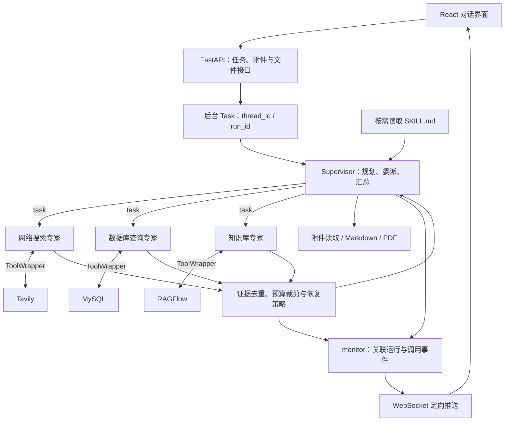

# DeepSearch Agents

**基于 Supervisor 主从架构的多源调研系统，围绕工具容错、证据预算与可复现评测完善 Agent 执行链路。**

系统按任务需要结合 Tavily 公开网页、MySQL 业务数据和 RAGFlow 内部文档，生成带来源的回答或 Markdown / PDF 报告。前端通过 WebSocket 展示专家委派、工具耗时、来源降级和任务状态，支持附件上传、产物下载与运行中取消。

在 Supervisor 主从多智能体与多源检索（Tavily / MySQL / RAGFlow）基础上，重点设计并实现了 **Agent Harness 执行治理层**：约束工具契约、控制证据上下文预算、管理跨源失败恢复，并通过 **64 项离线单测与 24 例基准评测**验证闭环。

## 快速审阅

| 关注点 | 实现入口 | 验证入口 |
| --- | --- | --- |
| 主控如何委派三类专家 | [main_agent.py](app/agent/main_agent.py)、[subagents/](app/agent/subagents/) | [真实 Agent 图测试](tests/test_agent_harness.py) |
| 工具故障如何分类与恢复 | [tool_wrapper.py](app/harness/tool_wrapper.py)、[research_policy.py](app/harness/research_policy.py) | [容错测试](tests/test_tool_wrapper.py)、[恢复策略测试](tests/test_research_policy.py) |
| 长证据如何去重和限额返回 | [context_trimmer.py](app/harness/context_trimmer.py)、[middleware.py](app/harness/middleware.py) | [裁剪测试](tests/test_context_trimmer.py) |
| 调研规范如何按需加载 | [skills/](skills/)、[skill_backend.py](app/harness/skill_backend.py) | [原生 Skill 加载测试](tests/test_skills.py) |
| 并发任务如何隔离与取消 | [server.py](app/api/server.py)、[runtime.py](app/harness/runtime.py)、[monitor.py](app/api/monitor.py) | [取消测试](tests/test_cancellation.py)、[接口与事件测试](tests/test_api_websocket.py) |
| 改造效果如何复现 | [评测脚本](eval/run_deep_research_benchmark.py)、[24 例数据集](eval/golden_dataset_24.json) | [评测报告](eval/EVALUATION_REPORT.md)、[逐例结果](eval/results.json) |

## 场景与架构

面向需要组合不同证据的调研任务，例如：

- **竞品分析**：检索公开产品资料，结合已有研究文档，按统一口径比较功能、价格、限制和适用场景。
- **技术综述**：梳理代表方法、评测条件、工程取舍与信息缺口，保留来源及冲突证据。
- **业务分析**：查询药品、库存、销售等结构化数据，必要时结合内部制度或研究文档生成交付报告。

三种来源按问题需要调用；存在数据依赖时顺序执行，独立子任务可以通过同一轮多个 `task` 调用并发执行。



主控只直接掌握附件与文档交付工具，数据获取工具分配给对应专家。`InMemorySaver` 按 `thread_id` 保存会话检查点；`ContextVar` 将当前会话、运行和子任务身份传入深层工具。

## 核心工程改造

### 1. 统一工具契约与有界恢复

Tavily、MySQL、RAGFlow 使用 Pydantic 输入输出模型，并统一为 `ToolExecutionResult`：

| 字段 | 用途 |
| --- | --- |
| `source`、`tool_name`、`call_id` | 标识来源与本次工具调用 |
| `status` | `ok` 或 `degraded`，区分有效结果与调用失败 |
| `data`、`evidence` | 来源专属的结构化数据及可追溯证据 |
| `error.code`、`error.reason`、`error.retryable` | 错误分类、归因与重试判断 |
| `attempts`、`cost_ms`、`warnings` | 尝试次数、调用耗时和附加说明 |

四类标准错误及处理方式：

| 错误 | 处理方式 |
| --- | --- |
| `TimeoutError` | 对可安全重试的读取操作有限重试，受总期限约束 |
| `ServiceUnavailable` | 临时连接故障可重试；缺失配置、鉴权问题直接降级 |
| `EmptyResult` | 说明没有获取到证据，允许改写问题或寻找适用来源 |
| `InvalidParam` | 返回修正依据，相同非法参数不重复执行 |

`ToolWrapper` 默认总期限为 20 秒、最多尝试两次。RAGFlow 问答会创建临时会话，因此设为单次尝试，并在 `finally` 中清理响应和会话。适配层同时补齐原生网络超时，避免只在外层停止等待而底层请求长期阻塞。

`DelegationHarnessMiddleware` 在真实 `task` 边界调用恢复策略，通过现有委派链路尝试适用的替代来源。内部库存、销售等事实采取保守来源规则，不以公开网页替代缺失的内部数据；证据不足时返回明确缺口。

MySQL 工具增加表名校验、只读 SQL 子集检查、行数限制和服务端只读事务。SQL 工具支持经过约束的只读查询子集，配合数据库只读账号形成执行层与权限层约束。

### 2. 证据去重与上下文预算

裁剪模块独立于模型和外部 API，处理步骤为：

1. **规范来源**：URL 归一化，去除明确的追踪参数，保留有语义的查询参数。
2. **识别重复**：规范化文本后用 SHA-256 精确去重，再用稳定的 64 位 SimHash 判断近似重复。
3. **保护差异**：数字、币种、单位或否定关系不同的片段保留，重复片段合并出处；同 URL 的不同有效段落可以共存。
4. **预算选择**：按问题匹配程度和来源分数排序，以完整句子或数据库行为单位选择内容，保护小数和相邻限定语。
5. **复核完整消息**：引用与 JSON 外壳计入预算，记录裁剪前后计数、去重数、丢弃数及截断标记。

两层接入位置：工具返回子 Agent 前设置 **6,000 代理计数单位**的输入保护；子任务返回 Supervisor 前默认执行 `max_tokens=1500` 的预算。裁剪保留 `ToolMessage` 的调用关联及 `Command` 的其它状态更新。有效原始证据归档在当前会话的 `.harness_evidence/`，不通过扩充主控上下文保存。

计数器优先使用已有本地 cl100k 词表缓存，缺失时使用 UTF-8 字节上界预算，执行路径不下载词表。预算与统计按 `tokenizer` 标识的计数单位执行；精确计费采用目标模型的 API usage。截断结果携带预算、来源与证据缺口信息，用于定向补查。

### 3. 调研规范 Skill 资产化

- [competitor-analysis](skills/competitor-analysis/SKILL.md)：统一竞品比较维度、数据口径、来源优先级和事实边界。
- [tech-survey](skills/tech-survey/SKILL.md)：定义技术分类、代表工作、评测条件、工程限制与引用要求。

使用 DeepAgents 原生 Skills 机制：先提供名称和描述，匹配任务后再读取正文。`CompositeBackend` 将 `/skills/` 路由到专用只读目录，其余 Agent 文件保留在 `StateBackend`，共享系统提示词只保存通用执行规则。

### 4. 事件追踪、并发隔离与安全取消

- `thread_id` 标识会话，`run_id` 标识一次执行，`subtask_id` 和 `call_id` 关联专家任务与工具调用。
- WebSocket 增加 `assistant_progress`、`tool_end`、`tool_degraded`、`context_trimmed`、`context_usage`；降级告警不会直接结束前端任务。
- 同会话的启动、替换和取消通过会话锁协调；不同会话可并发运行。
- 取消后停止后续重试和委派，传播 `CancelledError`，过滤旧运行的迟到结果。
- 同步 SDK 线程无法被 Python 强制终止，因此跟踪实际 worker，等待其按原生超时清理。旧运行未退出时，同会话替换返回 `409`，避免并发写入目录和检查点。

## 离线评测与结果

本地全量验证结果：**64 项 unittest 通过、24 例行为断言通过、前端 TypeScript 与 Vite 构建通过**。测试与评测使用 Mock 和脚本模型，不消耗外部真实 API。

数据集组成：

| 分类 | 数量 | 验证内容 |
| --- | ---: | --- |
| `normal_multi_source` | 12 | 多源取证、重复内容、预算约束和关键事实保留 |
| `single_source_fault_injection` | 7 | 六例单源超时/不可用，一例必要双源同时失效 |
| `conflict_and_out_of_scope` | 5 | 冲突证据保留、SQL 越界操作拒绝、内部事实来源约束 |

### 容错消融

相同故障集与三源调用计划下，评测要求至少两个不同的可用来源类别提供证据：

| 对照组 | 调研完成数 | 完成率 |
| --- | ---: | ---: |
| 基础异常捕获，无跨源恢复策略 | 4/7 | 57.1% |
| ToolWrapper 错误分类 + DelegationHarnessMiddleware 跨源恢复 | 6/7 | 85.7% |

唯一未完成的故障样本同时失去 Tavily 和 RAGFlow，仅剩 MySQL，不满足该样本的双来源要求，因此安全中止并保留错误归因。基础组保留工具异常捕获，增强组运行真实委派与补查路径。评测固定来源故障和证据要求，统计工具执行与恢复策略的完成率；实际委派轨迹随结果保存。

**24/24 是行为断言通过数**，同时覆盖调研完成、正确拒绝与安全中止；任务完成率在故障组中单独统计。

### 上下文裁剪消融

主指标为**单次调研任务累积注入主控的证据与消息上下文体积**：统计首次进入主控输入的用户消息、委派参数、证据和状态外壳；固定系统提示词与工具定义作为辅助开销单独记录，同一历史消息重放时不重复计量。

在分层合成长文本压力集上固定两轮取证（首轮三源，第二轮网页与文档核验），对比关闭裁剪与启用 **6000 输入保护 + 1500 子任务预算 + URL/SimHash 去重**。两个分组使用相同问题、原始事实、工具定义与调用计划。

| 指标 | 关闭裁剪 | 两级预算 + 去重 |
| --- | ---: | ---: |
| 平均每任务有效上下文体积（计数单位） | 14,083.4 | 8,031.4 |
| 上下文超阈次数 | 9/12 | 0/12 |
| 平均体积缩减 | — | **42.97%** |

压力集按紧凑、标准长页、扩展长页分为 3/6/3 例，包含镜像 URL、近重复正文与重复核验检索。预算阈值在数据集中预先定义为 **12,000 计数单位/任务**；超阈由逐例实测体积与该阈值比较得到。结果保存每条注入消息的规范化内容、计数和摘要，可独立复核统计公式。

本次计数单位为 UTF-8 字节预算（`utf8-byte-budget-v1 (proxy, conservative)`）。这些结果衡量该压力集的动态上下文预算消耗；目标模型的计费 Token、真实生成延迟和网络超时属于独立的在线评测项。包含固定框架定义的全量输入统计同时保留在报告和 JSON 中。

完整方法、逐例数据与代码指纹见 [EVALUATION_REPORT.md](eval/EVALUATION_REPORT.md) 和 [results.json](eval/results.json)。

## 技术栈与目录

| 层次 | 技术 |
| --- | --- |
| Agent 编排 | DeepAgents 0.5.7、LangGraph 1.1.10、LangChain 1.2.17 |
| 模型接入 | 支持工具调用的 OpenAI 兼容接口 |
| 数据来源 | Tavily、MySQL、RAGFlow |
| 执行治理 | Pydantic、ContextVar、asyncio、自定义 AgentMiddleware |
| 服务与实时事件 | FastAPI、Uvicorn、WebSocket |
| 前端 | React 19、TypeScript、Vite、Ant Design、Tailwind CSS |
| 验证 | unittest、Mock、FastAPI TestClient、离线故障注入与消融 |

```text
app/
├── agent/                  # Supervisor、三类专家配置、模型与提示词加载
├── api/                    # 任务接口、会话上下文、WebSocket 与事件路由
├── harness/
│   ├── schemas.py          # 工具输入输出、证据结构与错误枚举
│   ├── tool_wrapper.py     # 期限、重试、错误分类及降级反馈
│   ├── context_trimmer.py  # URL / 指纹去重、相关性选择与完整消息预算
│   ├── middleware.py       # 真实工具和委派边界接入、主控输入计量
│   ├── research_policy.py  # 来源兼容性、补查策略、冲突差异标记
│   ├── runtime.py          # 运行及子任务状态、取消与 worker 跟踪
│   ├── skill_backend.py    # 原生 Skill 的只读文件来源
│   ├── sql_guard.py        # 保守的只读 SQL 子集检查
│   └── token_counter.py    # 无下载执行路径的上下文代理计数
├── tools/                  # 来源适配、附件读取、Markdown / PDF 工具
├── ragflow/                # RAGFlow 配置与 SDK 适配
└── prompt/                 # 共享角色、路由和执行规则
frontend/src/               # 对话界面、事件处理、上传与下载
skills/                     # 竞品分析与技术综述规范
tests/                      # 离线单元及集成测试
eval/                       # 24 例数据、消融脚本、报告与逐例结果
docker/                     # MySQL Compose 与初始化 SQL
examples/                   # 框架能力示例
```

## 运行与复现

### 环境准备

需要 Python 3.12、uv；前端使用 Node.js 22.12+ 与 pnpm 10.33.0。下面以 Windows PowerShell 为例，命令均在仓库根目录执行。

首次安装依赖：

```powershell
uv sync --locked
pnpm --dir frontend install --frozen-lockfile
```

### 先运行离线验证

安装依赖后即可运行，无需真实模型、Tavily、MySQL 或 RAGFlow 服务：

```powershell
.\.venv\Scripts\python.exe -m unittest
.\.venv\Scripts\python.exe eval/run_deep_research_benchmark.py
pnpm --dir frontend build
```

评测脚本会打印对比表，并生成 `eval/EVALUATION_REPORT.md` 和 `eval/results.json`。脚本化模型用于验证实际执行链路；评分标签不参与取证决策。

### 配置真实服务

首次配置时将 [.env.example](.env.example) 复制为 `.env` 并填写实际参数；已有 `.env` 时直接检查配置，保留原内容。

| 配置 | 用途 |
| --- | --- |
| `OPENAI_BASE_URL`、`OPENAI_API_KEY`、`LLM_QWEN_MAX` | 模型接口与实际模型名称；模型需要支持工具调用 |
| `TAVILY_API_KEY` | 公开网页检索 |
| `MYSQL_HOST`、`MYSQL_PORT`、`MYSQL_USER`、`MYSQL_PASSWORD`、`MYSQL_DATABASE` | MySQL 连接 |
| `RAGFLOW_API_URL`、`RAGFLOW_API_KEY` | 独立 RAGFlow 服务及已配置的知识库助手 |

仓库 Compose 只启动 MySQL；RAGFlow 需单独准备，并完成模型配置、文档解析和 Chat 助手绑定。

需要使用本地示例数据库时执行：

```powershell
docker compose --env-file .env -f docker/docker-compose.yaml up -d
```

初始化 SQL 仅在首次使用空数据目录时导入。已有环境可直接复用；运行离线测试不需要启动数据库。

### 启动前后端

后端终端：

```powershell
.\.venv\Scripts\python.exe -m uvicorn app.api.server:app --host 127.0.0.1 --port 8000
```

前端另开终端：

```powershell
pnpm --dir frontend dev
```

- 页面：[http://localhost:5173](http://localhost:5173)
- API 文档：[http://127.0.0.1:8000/docs](http://127.0.0.1:8000/docs)
- 前端默认连接 `http://localhost:8000`，WebSocket 地址由 API 地址派生；可通过 `VITE_API_BASE_URL`、`VITE_WS_BASE_URL` 覆盖。

可从公开调研任务开始，例如“比较两类企业搜索方案，列出能力、限制及来源”。业务数据与内部文档任务需要相应来源已准备就绪。

### 接口与执行产物

| 接口 | 职责 |
| --- | --- |
| `POST /api/task` | 接收 `query`、可选 `thread_id`，返回启动状态、会话与运行 ID |
| `POST /api/task/{thread_id}/cancel` | 请求取消，返回 `cancelled` 或 `cancelling` |
| `WebSocket /ws/{thread_id}` | 当前会话的执行、降级、结果与取消事件 |
| `POST /api/upload` | 以 `files` 和 `thread_id` 关联上传附件 |
| `GET /api/files?path=...` | 列出输出目录中的交付文件 |
| `GET /api/download?path=...` | 下载输出文件 |

上传暂存于 `app/updated/session_{thread_id}`，执行时复制到 `app/output/session_{thread_id}`。原始证据归档与交付文件分开，文件列表不展示 `.harness_evidence/`。

## 当前边界与后续方向

- **验证分层**：离线评测覆盖工具执行、真实 Agent 图、故障恢复与前后端契约；在线评测聚焦目标模型回答质量、服务性能和API用量。
- **会话与部署**：当前采用单进程内存任务与检查点，按会话隔离目录和事件；生产扩展点包括鉴权、持久化检查点和跨进程调度。
- **事实与冲突**：保留来源及差异，数值冲突检测只标记相同句式的数字或日期变化；语义消歧仍需主控结合证据判断。
- **预算与成本**：分别计量动态证据与固定框架开销，子任务预算默认1500；容量规划进一步结合目标模型原生计数、历史压缩与工具定义优化。
- **恢复与取消**：按来源兼容规则补查，结合协作取消和SDK原生超时，在物理worker清理后释放同会话执行权。

`examples/` 提供框架能力示例。执行治理的核心代码位于 `app/harness/`，通过工具适配、专家委派、事件与任务生命周期接入应用；`skills/`、`tests/` 与 `eval/` 分别承载任务规范、回归验证和可复现评测。
